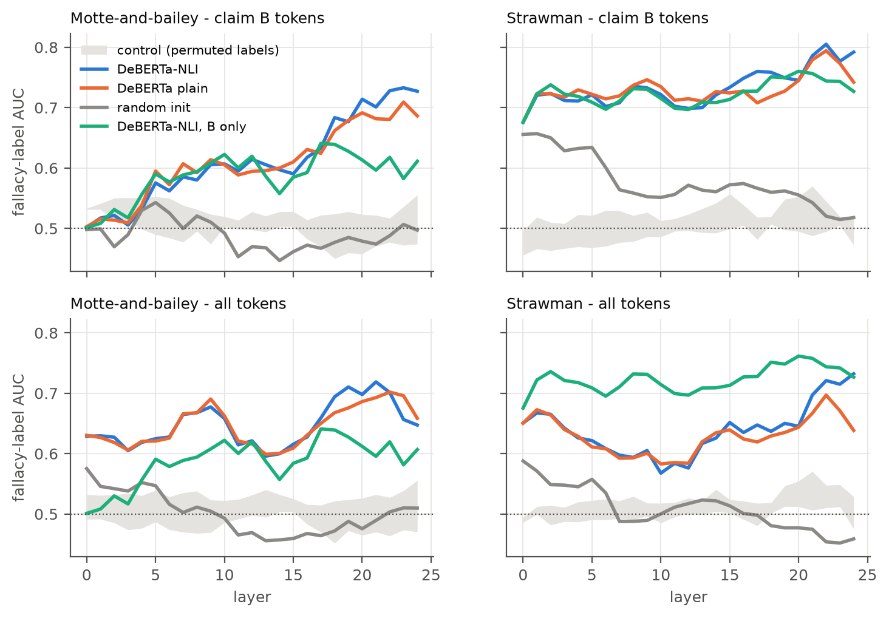
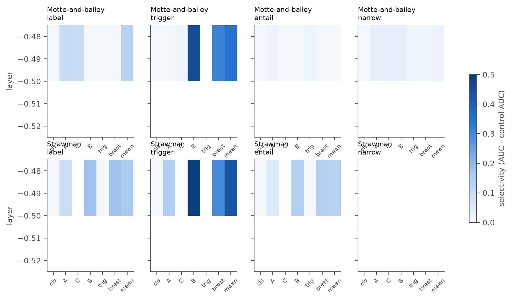
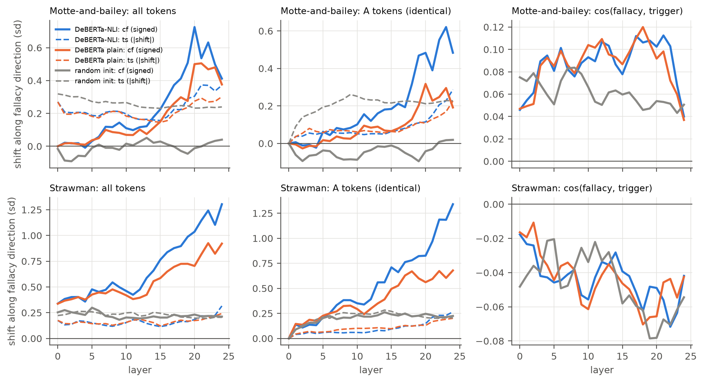
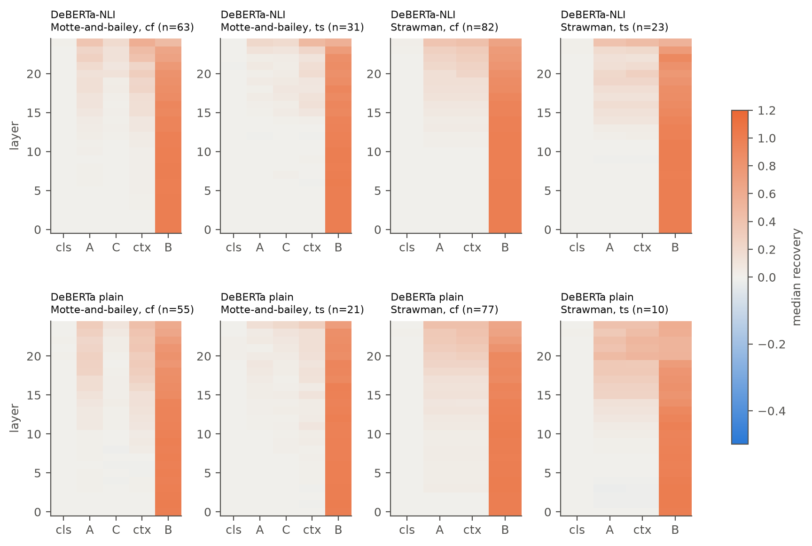
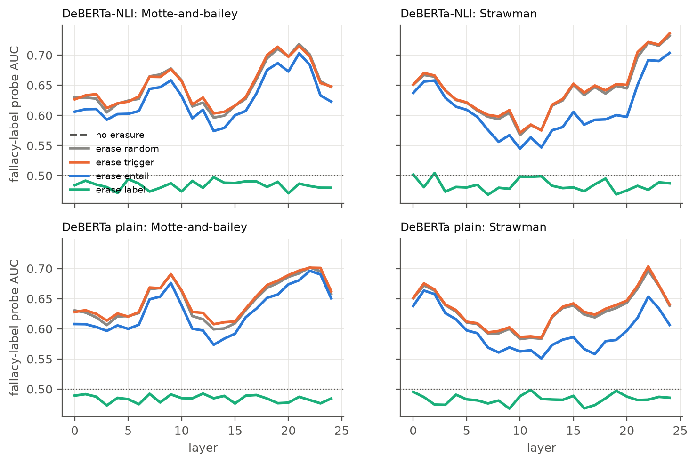
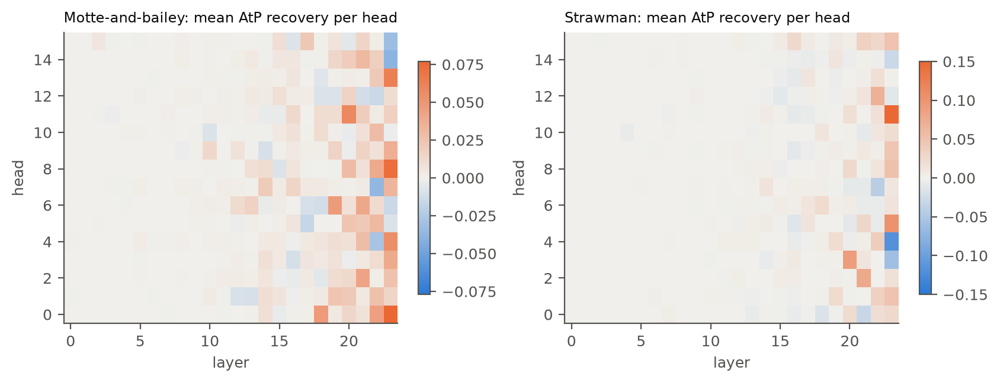
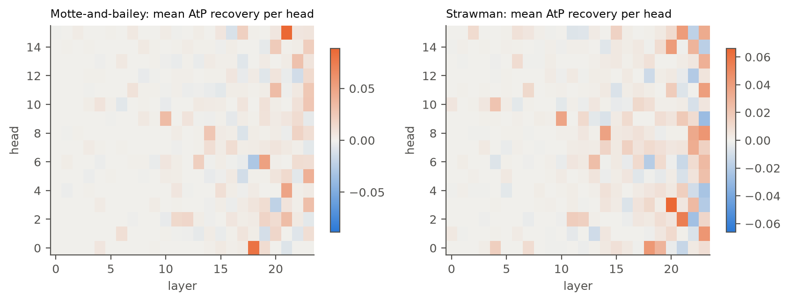

# Interpretability results (generated by analyze.py)

## Experiment 1 - layer x segment probing

Linear probes (standardised logistic regression, C=0.1), grouped 5-fold CV by conversation, 3 seeds. Control = same probe on randomly permuted labels; selectivity = AUC - control AUC.

### Fallacy label (best layer per segment)

| encoder | shape | segment | best_layer | best_auc | control_auc | selectivity | layer0_auc | last_auc |
|---|---|---|---|---|---|---|---|---|
| DeBERTa-NLI, B only | Motte-and-bailey | B | 17 | 0.641 | 0.470 | 0.171 | 0.502 | 0.611 |
| DeBERTa-NLI, B only | Motte-and-bailey | mean | 17 | 0.641 | 0.470 | 0.171 | 0.501 | 0.607 |
| DeBERTa-NLI, B only | Motte-and-bailey | cls | 21 | 0.696 | 0.523 | 0.173 | 0.483 | 0.649 |
| DeBERTa-NLI, B only | Strawman | B | 20 | 0.760 | 0.553 | 0.207 | 0.676 | 0.727 |
| DeBERTa-NLI, B only | Strawman | mean | 20 | 0.762 | 0.555 | 0.207 | 0.675 | 0.727 |
| DeBERTa-NLI, B only | Strawman | cls | 20 | 0.725 | 0.538 | 0.187 | 0.485 | 0.666 |
| DeBERTa-NLI | Motte-and-bailey | B | 23 | 0.733 | 0.513 | 0.220 | 0.502 | 0.727 |
| DeBERTa-NLI | Motte-and-bailey | mean | 21 | 0.719 | 0.514 | 0.205 | 0.629 | 0.647 |
| DeBERTa-NLI | Motte-and-bailey | A | 10 | 0.680 | 0.488 | 0.192 | 0.603 | 0.666 |
| DeBERTa-NLI | Motte-and-bailey | cls | 23 | 0.655 | 0.515 | 0.141 | 0.483 | 0.646 |
| DeBERTa-NLI | Strawman | B | 22 | 0.805 | 0.528 | 0.277 | 0.676 | 0.792 |
| DeBERTa-NLI | Strawman | mean | 24 | 0.732 | 0.529 | 0.203 | 0.651 | 0.732 |
| DeBERTa-NLI | Strawman | A | 23 | 0.762 | 0.528 | 0.234 | 0.618 | 0.743 |
| DeBERTa-NLI | Strawman | cls | 22 | 0.788 | 0.522 | 0.266 | 0.485 | 0.722 |
| DeBERTa plain | Motte-and-bailey | B | 23 | 0.709 | 0.472 | 0.237 | 0.503 | 0.686 |
| DeBERTa plain | Motte-and-bailey | mean | 22 | 0.702 | 0.464 | 0.238 | 0.630 | 0.658 |
| DeBERTa plain | Motte-and-bailey | A | 10 | 0.680 | 0.474 | 0.206 | 0.602 | 0.606 |
| DeBERTa plain | Motte-and-bailey | cls | 22 | 0.678 | 0.502 | 0.176 | 0.483 | 0.635 |
| DeBERTa plain | Strawman | B | 22 | 0.794 | 0.533 | 0.261 | 0.676 | 0.742 |
| DeBERTa plain | Strawman | mean | 22 | 0.697 | 0.517 | 0.180 | 0.650 | 0.638 |
| DeBERTa plain | Strawman | A | 23 | 0.668 | 0.514 | 0.153 | 0.620 | 0.645 |
| DeBERTa plain | Strawman | cls | 21 | 0.713 | 0.493 | 0.220 | 0.485 | 0.666 |
| random init | Motte-and-bailey | B | 5 | 0.543 | 0.553 | -0.010 | 0.498 | 0.497 |
| random init | Motte-and-bailey | mean | 0 | 0.575 | 0.510 | 0.065 | 0.575 | 0.510 |
| random init | Motte-and-bailey | A | 4 | 0.607 | 0.512 | 0.095 | 0.566 | 0.550 |
| random init | Motte-and-bailey | cls | 1 | 0.571 | 0.525 | 0.046 | 0.483 | 0.526 |
| random init | Strawman | B | 1 | 0.657 | 0.466 | 0.191 | 0.656 | 0.518 |
| random init | Strawman | mean | 0 | 0.588 | 0.491 | 0.097 | 0.588 | 0.459 |
| random init | Strawman | A | 4 | 0.620 | 0.498 | 0.122 | 0.573 | 0.453 |
| random init | Strawman | cls | 15 | 0.572 | 0.485 | 0.087 | 0.485 | 0.517 |

### Trigger presence, entailment (A => B), narrowing proxy

| encoder | target | shape | segment | best_layer | best_auc | control_auc | selectivity | layer0_auc | last_auc |
|---|---|---|---|---|---|---|---|---|---|
| DeBERTa-NLI | entail | Motte-and-bailey | B | 22 | 0.743 | 0.516 | 0.227 | 0.499 | 0.739 |
| DeBERTa-NLI | entail | Motte-and-bailey | mean | 24 | 0.696 | 0.522 | 0.174 | 0.508 | 0.696 |
| DeBERTa-NLI | entail | Motte-and-bailey | A | 24 | 0.751 | 0.532 | 0.219 | 0.549 | 0.751 |
| DeBERTa-NLI | entail | Motte-and-bailey | cls | 24 | 0.733 | 0.495 | 0.238 | 0.492 | 0.733 |
| DeBERTa-NLI | entail | Strawman | B | 24 | 0.901 | 0.524 | 0.378 | 0.621 | 0.901 |
| DeBERTa-NLI | entail | Strawman | mean | 24 | 0.893 | 0.545 | 0.347 | 0.623 | 0.893 |
| DeBERTa-NLI | entail | Strawman | A | 24 | 0.862 | 0.526 | 0.336 | 0.542 | 0.862 |
| DeBERTa-NLI | entail | Strawman | cls | 24 | 0.970 | 0.480 | 0.490 | 0.495 | 0.970 |
| DeBERTa-NLI | narrow | Motte-and-bailey | B | 24 | 0.672 | 0.471 | 0.201 | 0.504 | 0.672 |
| DeBERTa-NLI | narrow | Motte-and-bailey | mean | 24 | 0.647 | 0.488 | 0.159 | 0.492 | 0.647 |
| DeBERTa-NLI | narrow | Motte-and-bailey | A | 24 | 0.691 | 0.497 | 0.194 | 0.508 | 0.691 |
| DeBERTa-NLI | narrow | Motte-and-bailey | cls | 24 | 0.705 | 0.491 | 0.213 | 0.494 | 0.705 |
| DeBERTa-NLI | trigger | Motte-and-bailey | B | 11 | 0.959 | 0.499 | 0.461 | 0.939 | 0.897 |
| DeBERTa-NLI | trigger | Motte-and-bailey | mean | 21 | 0.907 | 0.500 | 0.408 | 0.848 | 0.844 |
| DeBERTa-NLI | trigger | Motte-and-bailey | A | 22 | 0.762 | 0.494 | 0.268 | 0.526 | 0.743 |
| DeBERTa-NLI | trigger | Motte-and-bailey | cls | 15 | 0.846 | 0.496 | 0.350 | 0.490 | 0.799 |
| DeBERTa-NLI | trigger | Strawman | B | 0 | 0.980 | 0.487 | 0.492 | 0.980 | 0.861 |
| DeBERTa-NLI | trigger | Strawman | mean | 0 | 0.910 | 0.480 | 0.430 | 0.910 | 0.803 |
| DeBERTa-NLI | trigger | Strawman | A | 3 | 0.765 | 0.484 | 0.281 | 0.621 | 0.740 |
| DeBERTa-NLI | trigger | Strawman | cls | 12 | 0.823 | 0.484 | 0.340 | 0.488 | 0.747 |
| DeBERTa plain | entail | Motte-and-bailey | B | 23 | 0.627 | 0.506 | 0.121 | 0.500 | 0.604 |
| DeBERTa plain | entail | Motte-and-bailey | mean | 24 | 0.610 | 0.499 | 0.111 | 0.507 | 0.610 |
| DeBERTa plain | entail | Motte-and-bailey | A | 24 | 0.610 | 0.507 | 0.102 | 0.548 | 0.610 |
| DeBERTa plain | entail | Motte-and-bailey | cls | 14 | 0.618 | 0.507 | 0.111 | 0.492 | 0.562 |
| DeBERTa plain | entail | Strawman | B | 20 | 0.730 | 0.526 | 0.204 | 0.621 | 0.691 |
| DeBERTa plain | entail | Strawman | mean | 11 | 0.697 | 0.495 | 0.202 | 0.623 | 0.610 |
| DeBERTa plain | entail | Strawman | A | 23 | 0.663 | 0.501 | 0.162 | 0.542 | 0.623 |
| DeBERTa plain | entail | Strawman | cls | 22 | 0.696 | 0.491 | 0.205 | 0.495 | 0.604 |
| DeBERTa plain | narrow | Motte-and-bailey | B | 21 | 0.624 | 0.511 | 0.113 | 0.504 | 0.618 |
| DeBERTa plain | narrow | Motte-and-bailey | mean | 23 | 0.518 | 0.502 | 0.016 | 0.492 | 0.516 |
| DeBERTa plain | narrow | Motte-and-bailey | A | 8 | 0.581 | 0.483 | 0.098 | 0.509 | 0.532 |
| DeBERTa plain | narrow | Motte-and-bailey | cls | 22 | 0.583 | 0.522 | 0.061 | 0.494 | 0.580 |
| DeBERTa plain | trigger | Motte-and-bailey | B | 11 | 0.954 | 0.493 | 0.461 | 0.939 | 0.932 |
| DeBERTa plain | trigger | Motte-and-bailey | mean | 22 | 0.898 | 0.502 | 0.396 | 0.848 | 0.869 |
| DeBERTa plain | trigger | Motte-and-bailey | A | 23 | 0.691 | 0.492 | 0.199 | 0.526 | 0.691 |
| DeBERTa plain | trigger | Motte-and-bailey | cls | 17 | 0.811 | 0.496 | 0.315 | 0.490 | 0.793 |
| DeBERTa plain | trigger | Strawman | B | 0 | 0.979 | 0.488 | 0.492 | 0.979 | 0.913 |
| DeBERTa plain | trigger | Strawman | mean | 0 | 0.910 | 0.480 | 0.429 | 0.910 | 0.856 |
| DeBERTa plain | trigger | Strawman | A | 24 | 0.786 | 0.498 | 0.288 | 0.621 | 0.786 |
| DeBERTa plain | trigger | Strawman | cls | 23 | 0.826 | 0.470 | 0.355 | 0.488 | 0.805 |
| random init | entail | Motte-and-bailey | B | 22 | 0.548 | 0.527 | 0.021 | 0.429 | 0.535 |
| random init | entail | Motte-and-bailey | mean | 9 | 0.543 | 0.522 | 0.022 | 0.481 | 0.533 |
| random init | entail | Motte-and-bailey | A | 8 | 0.565 | 0.508 | 0.057 | 0.561 | 0.535 |
| random init | entail | Motte-and-bailey | cls | 10 | 0.548 | 0.513 | 0.035 | 0.492 | 0.535 |
| random init | entail | Strawman | B | 0 | 0.617 | 0.487 | 0.130 | 0.617 | 0.533 |
| random init | entail | Strawman | mean | 0 | 0.608 | 0.486 | 0.122 | 0.608 | 0.517 |
| random init | entail | Strawman | A | 14 | 0.571 | 0.495 | 0.076 | 0.542 | 0.505 |
| random init | entail | Strawman | cls | 2 | 0.611 | 0.515 | 0.096 | 0.495 | 0.509 |
| random init | narrow | Motte-and-bailey | B | 24 | 0.516 | 0.509 | 0.007 | 0.459 | 0.516 |
| random init | narrow | Motte-and-bailey | mean | 1 | 0.554 | 0.507 | 0.047 | 0.528 | 0.533 |
| random init | narrow | Motte-and-bailey | A | 9 | 0.626 | 0.519 | 0.107 | 0.547 | 0.566 |
| random init | narrow | Motte-and-bailey | cls | 7 | 0.554 | 0.533 | 0.022 | 0.494 | 0.517 |
| random init | trigger | Motte-and-bailey | B | 0 | 0.926 | 0.486 | 0.441 | 0.926 | 0.808 |
| random init | trigger | Motte-and-bailey | mean | 0 | 0.853 | 0.488 | 0.366 | 0.853 | 0.764 |
| random init | trigger | Motte-and-bailey | A | 7 | 0.790 | 0.512 | 0.279 | 0.486 | 0.777 |
| random init | trigger | Motte-and-bailey | cls | 2 | 0.834 | 0.504 | 0.331 | 0.490 | 0.774 |
| random init | trigger | Strawman | B | 0 | 0.988 | 0.490 | 0.498 | 0.988 | 0.872 |
| random init | trigger | Strawman | mean | 1 | 0.919 | 0.509 | 0.409 | 0.918 | 0.836 |
| random init | trigger | Strawman | A | 6 | 0.889 | 0.473 | 0.416 | 0.606 | 0.843 |
| random init | trigger | Strawman | cls | 4 | 0.906 | 0.507 | 0.398 | 0.488 | 0.844 |

## Experiment 2 - minimal pairs along the fallacy direction

Probes fit on training conversations only; each held-out pair's shift along the fallacy-probe logit, in held-out sd units. cf = counterfactual (label flips, trigger kept), signed toward the new label; ts = trigger swap (label kept), absolute. Segment A has identical tokens in both members, so a shift at A is information moved from B by attention.

### cf signed shift vs ts absolute shift (all tokens), cluster-bootstrap 95% CI of the difference

| encoder | shape | layer | cf_signed_shift | ts_abs_shift | diff | ci_lo | ci_hi | cf_both_correct | ts_pred_kept |
|---|---|---|---|---|---|---|---|---|---|
| DeBERTa-NLI | Motte-and-bailey | 0 | -0.000 | 0.270 | -0.271 | -0.404 | -0.156 | 0.054 | 0.904 |
| DeBERTa-NLI | Motte-and-bailey | 12 | 0.116 | 0.163 | -0.047 | -0.123 | 0.032 | 0.083 | 0.946 |
| DeBERTa-NLI | Motte-and-bailey | 18 | 0.412 | 0.223 | 0.189 | 0.077 | 0.291 | 0.189 | 0.958 |
| DeBERTa-NLI | Motte-and-bailey | 24 | 0.412 | 0.371 | 0.041 | -0.194 | 0.276 | 0.196 | 0.869 |
| DeBERTa-NLI | Strawman | 0 | 0.338 | 0.174 | 0.164 | 0.015 | 0.304 | 0.186 | 0.923 |
| DeBERTa-NLI | Strawman | 12 | 0.475 | 0.173 | 0.302 | 0.185 | 0.412 | 0.228 | 0.923 |
| DeBERTa-NLI | Strawman | 18 | 0.897 | 0.164 | 0.732 | 0.569 | 0.888 | 0.337 | 0.933 |
| DeBERTa-NLI | Strawman | 24 | 1.304 | 0.315 | 0.988 | 0.732 | 1.222 | 0.497 | 0.894 |
| DeBERTa plain | Motte-and-bailey | 0 | 0.000 | 0.270 | -0.270 | -0.401 | -0.155 | 0.054 | 0.904 |
| DeBERTa plain | Motte-and-bailey | 12 | 0.102 | 0.164 | -0.063 | -0.141 | 0.016 | 0.077 | 0.946 |
| DeBERTa plain | Motte-and-bailey | 18 | 0.298 | 0.219 | 0.079 | -0.020 | 0.180 | 0.141 | 0.946 |
| DeBERTa plain | Motte-and-bailey | 24 | 0.376 | 0.302 | 0.074 | -0.106 | 0.266 | 0.135 | 0.923 |
| DeBERTa plain | Strawman | 0 | 0.337 | 0.175 | 0.163 | 0.017 | 0.302 | 0.189 | 0.936 |
| DeBERTa plain | Strawman | 12 | 0.395 | 0.187 | 0.209 | 0.104 | 0.310 | 0.173 | 0.920 |
| DeBERTa plain | Strawman | 18 | 0.724 | 0.177 | 0.547 | 0.404 | 0.675 | 0.282 | 0.913 |
| DeBERTa plain | Strawman | 24 | 0.921 | 0.242 | 0.679 | 0.485 | 0.866 | 0.346 | 0.939 |
| random init | Motte-and-bailey | 0 | -0.016 | 0.319 | -0.335 | -0.480 | -0.188 | 0.071 | 0.923 |
| random init | Motte-and-bailey | 12 | 0.028 | 0.239 | -0.211 | -0.312 | -0.092 | 0.083 | 0.933 |
| random init | Motte-and-bailey | 18 | -0.028 | 0.247 | -0.276 | -0.382 | -0.155 | 0.074 | 0.907 |
| random init | Motte-and-bailey | 24 | 0.040 | 0.239 | -0.199 | -0.306 | -0.081 | 0.083 | 0.917 |
| random init | Strawman | 0 | 0.253 | 0.222 | 0.031 | -0.123 | 0.176 | 0.167 | 0.936 |
| random init | Strawman | 12 | 0.194 | 0.216 | -0.022 | -0.158 | 0.122 | 0.157 | 0.923 |
| random init | Strawman | 18 | 0.215 | 0.208 | 0.007 | -0.133 | 0.156 | 0.144 | 0.936 |
| random init | Strawman | 24 | 0.212 | 0.205 | 0.007 | -0.136 | 0.159 | 0.131 | 0.949 |

## Experiment 3 - residual-stream activation patching

Frozen encoder + layer-24 mean-pooled linear readout (fold-wise, conversation held out). clean = original, corrupt = edit. Recovery = fraction of the clean-corrupt readout gap restored by patching a segment's states at one layer (B: clean run with corrupt context, i.e. only clean B left). Pairs with |gap| < 0.5 readout-sd are excluded. Mean recovery is shown; 1 = segment carries the whole effect.

### Size of the readout change per pair (|LD_clean - LD_corrupt| in readout sd)

| encoder | shape | edit_type | pairs | mean_abs_gap_sd | kept |
|---|---|---|---|---|---|
| nli | motte_bailey | cf | 104 | 1.020 | 0.606 |
| nli | motte_bailey | ts | 104 | 0.351 | 0.298 |
| nli | strawman | cf | 104 | 1.360 | 0.788 |
| nli | strawman | ts | 104 | 0.318 | 0.221 |
| plain | motte_bailey | cf | 104 | 0.712 | 0.529 |
| plain | motte_bailey | ts | 104 | 0.286 | 0.202 |
| plain | strawman | cf | 104 | 1.035 | 0.740 |
| plain | strawman | ts | 104 | 0.232 | 0.096 |

### Median recovery at selected layers

| encoder | shape | edit | layer | A | B | C | cls | ctx |
|---|---|---|---|---|---|---|---|---|
| DeBERTa plain | Motte-and-bailey | cf | 6 | 0.008 | 0.983 | -0.006 | -0.000 | -0.004 |
| DeBERTa plain | Motte-and-bailey | cf | 12 | 0.072 | 0.949 | 0.016 | -0.000 | 0.097 |
| DeBERTa plain | Motte-and-bailey | cf | 18 | 0.246 | 0.851 | 0.009 | 0.000 | 0.300 |
| DeBERTa plain | Motte-and-bailey | cf | 23 | 0.276 | 0.638 | 0.068 | 0.006 | 0.375 |
| DeBERTa plain | Motte-and-bailey | ts | 6 | 0.005 | 0.985 | 0.003 | -0.000 | 0.016 |
| DeBERTa plain | Motte-and-bailey | ts | 12 | 0.016 | 0.985 | 0.012 | -0.000 | 0.050 |
| DeBERTa plain | Motte-and-bailey | ts | 18 | 0.075 | 0.922 | 0.031 | -0.000 | 0.129 |
| DeBERTa plain | Motte-and-bailey | ts | 23 | 0.048 | 0.844 | 0.110 | -0.001 | 0.148 |
| DeBERTa plain | Strawman | cf | 6 | 0.033 | 0.997 | nan | 0.000 | 0.032 |
| DeBERTa plain | Strawman | cf | 12 | 0.068 | 0.992 | nan | -0.000 | 0.069 |
| DeBERTa plain | Strawman | cf | 18 | 0.195 | 0.911 | nan | 0.000 | 0.196 |
| DeBERTa plain | Strawman | cf | 23 | 0.346 | 0.669 | nan | 0.014 | 0.395 |
| DeBERTa plain | Strawman | ts | 6 | 0.009 | 0.966 | nan | -0.000 | 0.009 |
| DeBERTa plain | Strawman | ts | 12 | 0.082 | 0.943 | nan | 0.000 | 0.082 |
| DeBERTa plain | Strawman | ts | 18 | 0.342 | 0.791 | nan | 0.000 | 0.342 |
| DeBERTa plain | Strawman | ts | 23 | 0.342 | 0.580 | nan | 0.012 | 0.442 |
| DeBERTa-NLI | Motte-and-bailey | cf | 6 | 0.016 | 0.991 | 0.007 | -0.000 | 0.021 |
| DeBERTa-NLI | Motte-and-bailey | cf | 12 | 0.036 | 0.975 | 0.014 | -0.000 | 0.047 |
| DeBERTa-NLI | Motte-and-bailey | cf | 18 | 0.149 | 0.858 | 0.040 | -0.000 | 0.229 |
| DeBERTa-NLI | Motte-and-bailey | cf | 23 | 0.233 | 0.652 | 0.124 | 0.005 | 0.459 |
| DeBERTa-NLI | Motte-and-bailey | ts | 6 | -0.003 | 1.006 | 0.002 | -0.000 | -0.005 |
| DeBERTa-NLI | Motte-and-bailey | ts | 12 | -0.006 | 0.970 | -0.001 | 0.000 | -0.007 |
| DeBERTa-NLI | Motte-and-bailey | ts | 18 | 0.014 | 0.922 | 0.077 | -0.000 | 0.081 |
| DeBERTa-NLI | Motte-and-bailey | ts | 23 | 0.113 | 0.737 | 0.101 | 0.006 | 0.222 |
| DeBERTa-NLI | Strawman | cf | 6 | 0.003 | 0.998 | nan | 0.000 | 0.003 |
| DeBERTa-NLI | Strawman | cf | 12 | 0.023 | 0.986 | nan | 0.000 | 0.025 |
| DeBERTa-NLI | Strawman | cf | 18 | 0.134 | 0.885 | nan | 0.000 | 0.135 |
| DeBERTa-NLI | Strawman | cf | 23 | 0.280 | 0.741 | nan | 0.018 | 0.326 |
| DeBERTa-NLI | Strawman | ts | 6 | 0.004 | 0.995 | nan | -0.000 | 0.004 |
| DeBERTa-NLI | Strawman | ts | 12 | 0.027 | 0.974 | nan | 0.000 | 0.030 |
| DeBERTa-NLI | Strawman | ts | 18 | 0.158 | 0.857 | nan | -0.000 | 0.157 |
| DeBERTa-NLI | Strawman | ts | 23 | 0.186 | 0.749 | nan | 0.014 | 0.200 |

## Experiment 4 - concept erasure (LEACE)

### (a) Amnesic probing on cached features (label-probe AUC after erasing a concept; all tokens)

| encoder | shape | layer | entail | label | none | random | trigger |
|---|---|---|---|---|---|---|---|
| nli_pair | motte_bailey | 0 | 0.606 | 0.484 | 0.629 | 0.629 | 0.627 |
| nli_pair | motte_bailey | 6 | 0.607 | 0.487 | 0.628 | 0.627 | 0.631 |
| nli_pair | motte_bailey | 12 | 0.609 | 0.480 | 0.621 | 0.621 | 0.629 |
| nli_pair | motte_bailey | 18 | 0.675 | 0.481 | 0.694 | 0.695 | 0.700 |
| nli_pair | motte_bailey | 24 | 0.623 | 0.480 | 0.647 | 0.647 | 0.648 |
| nli_pair | strawman | 0 | 0.637 | 0.502 | 0.651 | 0.651 | 0.651 |
| nli_pair | strawman | 6 | 0.598 | 0.485 | 0.608 | 0.608 | 0.610 |
| nli_pair | strawman | 12 | 0.547 | 0.499 | 0.576 | 0.576 | 0.575 |
| nli_pair | strawman | 18 | 0.593 | 0.495 | 0.637 | 0.636 | 0.642 |
| nli_pair | strawman | 24 | 0.704 | 0.487 | 0.732 | 0.732 | 0.736 |
| plain_pair | motte_bailey | 0 | 0.608 | 0.489 | 0.630 | 0.630 | 0.628 |
| plain_pair | motte_bailey | 6 | 0.607 | 0.475 | 0.626 | 0.626 | 0.628 |
| plain_pair | motte_bailey | 12 | 0.597 | 0.493 | 0.616 | 0.616 | 0.627 |
| plain_pair | motte_bailey | 18 | 0.651 | 0.484 | 0.668 | 0.668 | 0.673 |
| plain_pair | motte_bailey | 24 | 0.651 | 0.484 | 0.658 | 0.658 | 0.662 |
| plain_pair | strawman | 0 | 0.638 | 0.495 | 0.650 | 0.650 | 0.651 |
| plain_pair | strawman | 6 | 0.593 | 0.481 | 0.608 | 0.608 | 0.609 |
| plain_pair | strawman | 12 | 0.551 | 0.484 | 0.584 | 0.584 | 0.585 |
| plain_pair | strawman | 18 | 0.579 | 0.485 | 0.629 | 0.628 | 0.633 |
| plain_pair | strawman | 24 | 0.607 | 0.486 | 0.638 | 0.638 | 0.640 |

### (b) DeBERTa-NLI: erase at layer l inside the forward pass, layer-24 readout AUC on held-out rows (layer -1 = no erasure)

| shape | layer | entail | none | random | trigger |
|---|---|---|---|---|---|
| Motte-and-bailey | -1 | nan | 0.655 | nan | nan |
| Motte-and-bailey | 0 | 0.654 | nan | 0.654 | 0.656 |
| Motte-and-bailey | 2 | 0.654 | nan | 0.654 | 0.656 |
| Motte-and-bailey | 4 | 0.653 | nan | 0.655 | 0.658 |
| Motte-and-bailey | 6 | 0.654 | nan | 0.654 | 0.661 |
| Motte-and-bailey | 8 | 0.649 | nan | 0.653 | 0.660 |
| Motte-and-bailey | 10 | 0.649 | nan | 0.653 | 0.649 |
| Motte-and-bailey | 12 | 0.654 | nan | 0.653 | 0.644 |
| Motte-and-bailey | 14 | 0.655 | nan | 0.654 | 0.644 |
| Motte-and-bailey | 16 | 0.652 | nan | 0.653 | 0.653 |
| Motte-and-bailey | 18 | 0.648 | nan | 0.652 | 0.658 |
| Motte-and-bailey | 20 | 0.650 | nan | 0.656 | 0.656 |
| Motte-and-bailey | 22 | 0.628 | nan | 0.648 | 0.643 |
| Motte-and-bailey | 24 | 0.628 | nan | 0.653 | 0.656 |
| Strawman | -1 | nan | 0.713 | nan | nan |
| Strawman | 0 | 0.712 | nan | 0.712 | 0.718 |
| Strawman | 2 | 0.715 | nan | 0.713 | 0.713 |
| Strawman | 4 | 0.712 | nan | 0.712 | 0.715 |
| Strawman | 6 | 0.711 | nan | 0.712 | 0.713 |
| Strawman | 8 | 0.708 | nan | 0.713 | 0.713 |
| Strawman | 10 | 0.712 | nan | 0.713 | 0.704 |
| Strawman | 12 | 0.709 | nan | 0.713 | 0.709 |
| Strawman | 14 | 0.706 | nan | 0.711 | 0.705 |
| Strawman | 16 | 0.709 | nan | 0.711 | 0.707 |
| Strawman | 18 | 0.713 | nan | 0.715 | 0.701 |
| Strawman | 20 | 0.698 | nan | 0.710 | 0.702 |
| Strawman | 22 | 0.716 | nan | 0.714 | 0.706 |
| Strawman | 24 | 0.663 | nan | 0.711 | 0.715 |

### (b) DeBERTa plain: erase at layer l inside the forward pass, layer-24 readout AUC on held-out rows (layer -1 = no erasure)

| shape | layer | entail | none | random | trigger |
|---|---|---|---|---|---|
| Motte-and-bailey | -1 | nan | 0.639 | nan | nan |
| Motte-and-bailey | 0 | 0.638 | nan | 0.639 | 0.637 |
| Motte-and-bailey | 2 | 0.634 | nan | 0.638 | 0.636 |
| Motte-and-bailey | 4 | 0.630 | nan | 0.640 | 0.636 |
| Motte-and-bailey | 6 | 0.634 | nan | 0.637 | 0.631 |
| Motte-and-bailey | 8 | 0.630 | nan | 0.638 | 0.626 |
| Motte-and-bailey | 10 | 0.628 | nan | 0.637 | 0.626 |
| Motte-and-bailey | 12 | 0.631 | nan | 0.639 | 0.621 |
| Motte-and-bailey | 14 | 0.632 | nan | 0.638 | 0.618 |
| Motte-and-bailey | 16 | 0.632 | nan | 0.636 | 0.621 |
| Motte-and-bailey | 18 | 0.633 | nan | 0.644 | 0.635 |
| Motte-and-bailey | 20 | 0.628 | nan | 0.628 | 0.631 |
| Motte-and-bailey | 22 | 0.646 | nan | 0.640 | 0.640 |
| Motte-and-bailey | 24 | 0.627 | nan | 0.645 | 0.638 |
| Strawman | -1 | nan | 0.627 | nan | nan |
| Strawman | 0 | 0.626 | nan | 0.627 | 0.628 |
| Strawman | 2 | 0.624 | nan | 0.628 | 0.627 |
| Strawman | 4 | 0.625 | nan | 0.627 | 0.626 |
| Strawman | 6 | 0.626 | nan | 0.628 | 0.624 |
| Strawman | 8 | 0.631 | nan | 0.627 | 0.626 |
| Strawman | 10 | 0.629 | nan | 0.628 | 0.627 |
| Strawman | 12 | 0.622 | nan | 0.627 | 0.625 |
| Strawman | 14 | 0.629 | nan | 0.626 | 0.617 |
| Strawman | 16 | 0.631 | nan | 0.628 | 0.624 |
| Strawman | 18 | 0.625 | nan | 0.633 | 0.625 |
| Strawman | 20 | 0.616 | nan | 0.625 | 0.635 |
| Strawman | 22 | 0.604 | nan | 0.630 | 0.621 |
| Strawman | 24 | 0.595 | nan | 0.626 | 0.626 |

## Heads and MLPs (DeBERTa-NLI)

Attribution patching on counterfactual pairs at the context positions (B-dependent information written into [CLS]/A/C), verified by real patching; mean-ablation of the top-10 heads on held-out real rows.

### Top components: AtP estimate vs real patching (median recovery)

| shape | comp | atp | patched_recovery | pairs |
|---|---|---|---|---|
| motte_bailey | L21MLP | 0.225 | 0.222 | 63 |
| motte_bailey | L22MLP | 0.205 | 0.232 | 63 |
| motte_bailey | L23MLP | 0.096 | 0.144 | 63 |
| motte_bailey | L23H0 | 0.077 | 0.040 | 63 |
| motte_bailey | L23H8 | 0.073 | 0.065 | 63 |
| motte_bailey | L23H13 | 0.063 | 0.062 | 63 |
| motte_bailey | L20H11 | 0.058 | 0.045 | 63 |
| motte_bailey | L23H4 | 0.054 | 0.042 | 63 |
| motte_bailey | L18H0 | 0.048 | 0.037 | 63 |
| motte_bailey | L19H6 | 0.047 | 0.034 | 63 |
| motte_bailey | L22H0 | 0.045 | 0.021 | 63 |
| motte_bailey | L21H2 | 0.042 | 0.028 | 63 |
| motte_bailey | L21H6 | 0.041 | 0.035 | 63 |
| strawman | L23H11 | 0.150 | 0.105 | 82 |
| strawman | L23MLP | 0.148 | 0.133 | 82 |
| strawman | L22MLP | 0.112 | 0.113 | 82 |
| strawman | L23H5 | 0.102 | 0.119 | 82 |
| strawman | L20H3 | 0.091 | 0.079 | 82 |
| strawman | L21H2 | 0.078 | 0.092 | 82 |
| strawman | L21MLP | 0.078 | 0.082 | 82 |
| strawman | L22H12 | 0.068 | 0.061 | 82 |
| strawman | L23H8 | 0.050 | 0.051 | 82 |
| strawman | L23H15 | 0.049 | 0.040 | 82 |
| strawman | L23H1 | 0.048 | 0.035 | 82 |
| strawman | L23H9 | 0.045 | 0.048 | 82 |
| strawman | L22H4 | 0.038 | 0.024 | 82 |

### Mean-ablation on held-out real rows

| shape | condition | auc | mean_logit_pos_minus_neg |
|---|---|---|---|
| Motte-and-bailey | none | 0.655 | 1.325 |
| Motte-and-bailey | random | 0.579 | 0.690 |
| Motte-and-bailey | top | 0.607 | 0.873 |
| Motte-and-bailey | top1_L23H0 | 0.659 | 1.403 |
| Motte-and-bailey | top1_L23H13 | 0.641 | 1.168 |
| Motte-and-bailey | top1_L23H8 | 0.632 | 1.119 |
| Strawman | none | 0.713 | 1.988 |
| Strawman | random | 0.690 | 1.673 |
| Strawman | top | 0.443 | -0.408 |
| Strawman | top1_L20H3 | 0.701 | 1.864 |
| Strawman | top1_L23H11 | 0.654 | 1.320 |
| Strawman | top1_L23H5 | 0.683 | 1.606 |

## Heads and MLPs (DeBERTa plain)

Attribution patching on counterfactual pairs at the context positions (B-dependent information written into [CLS]/A/C), verified by real patching; mean-ablation of the top-10 heads on held-out real rows.

### Top components: AtP estimate vs real patching (median recovery)

| shape | comp | atp | patched_recovery | pairs |
|---|---|---|---|---|
| motte_bailey | L22MLP | 0.101 | 0.110 | 55 |
| motte_bailey | L21H15 | 0.089 | 0.060 | 55 |
| motte_bailey | L18H0 | 0.080 | 0.070 | 55 |
| motte_bailey | L19MLP | 0.063 | 0.066 | 55 |
| motte_bailey | L18MLP | 0.062 | 0.061 | 55 |
| motte_bailey | L19H6 | 0.051 | 0.041 | 55 |
| motte_bailey | L21H4 | 0.049 | 0.027 | 55 |
| motte_bailey | L23H5 | 0.041 | 0.016 | 55 |
| motte_bailey | L10H9 | 0.034 | 0.016 | 55 |
| motte_bailey | L20H11 | 0.033 | 0.035 | 55 |
| motte_bailey | L21H2 | 0.033 | 0.025 | 55 |
| motte_bailey | L23H3 | 0.032 | 0.029 | 55 |
| motte_bailey | L22H13 | 0.030 | 0.017 | 55 |
| strawman | L19MLP | 0.099 | 0.090 | 77 |
| strawman | L18MLP | 0.083 | 0.072 | 77 |
| strawman | L20H3 | 0.066 | 0.034 | 77 |
| strawman | L23MLP | 0.063 | 0.056 | 77 |
| strawman | L21H2 | 0.055 | 0.020 | 77 |
| strawman | L23H8 | 0.043 | 0.030 | 77 |
| strawman | L23H1 | 0.043 | 0.031 | 77 |
| strawman | L18H0 | 0.042 | 0.017 | 77 |
| strawman | L20H14 | 0.041 | 0.021 | 77 |
| strawman | L21H15 | 0.041 | 0.041 | 77 |
| strawman | L23H11 | 0.040 | 0.032 | 77 |
| strawman | L14H8 | 0.038 | 0.020 | 77 |
| strawman | L10H9 | 0.037 | 0.012 | 77 |

### Mean-ablation on held-out real rows

| shape | condition | auc | mean_logit_pos_minus_neg |
|---|---|---|---|
| Motte-and-bailey | none | 0.639 | 1.289 |
| Motte-and-bailey | random | 0.619 | 1.125 |
| Motte-and-bailey | top | 0.620 | 0.876 |
| Motte-and-bailey | top1_L18H0 | 0.628 | 1.192 |
| Motte-and-bailey | top1_L19H6 | 0.647 | 1.296 |
| Motte-and-bailey | top1_L21H15 | 0.642 | 1.296 |
| Strawman | none | 0.627 | 1.335 |
| Strawman | random | 0.625 | 1.309 |
| Strawman | top | 0.603 | 1.017 |
| Strawman | top1_L20H3 | 0.615 | 1.198 |
| Strawman | top1_L21H2 | 0.621 | 1.242 |
| Strawman | top1_L23H8 | 0.631 | 1.364 |
